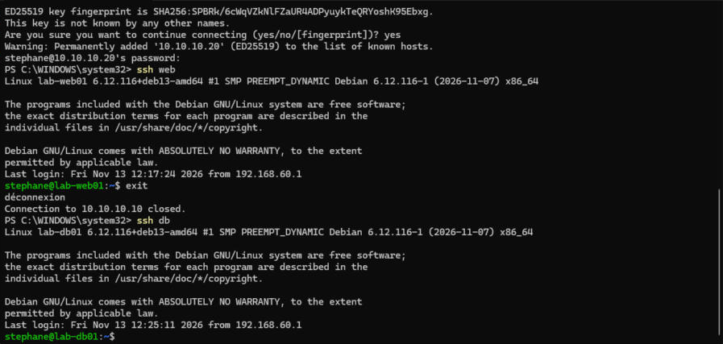
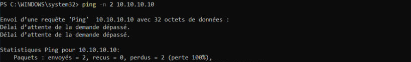
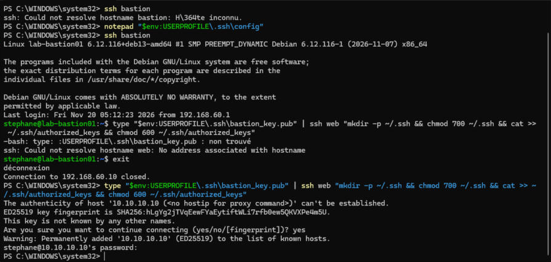
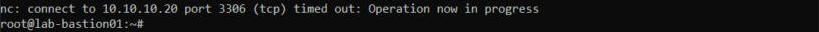

🇫🇷 [Français](README.md) · 🇬🇧 **English**

# 🛡️ Lab — One single way in: building an SSH bastion from scratch

> **Debian 13 · VMware Workstation · SSH ProxyJump · nftables · Nginx · MariaDB**
> Training project — *Secure Infrastructure Administrator* (French professional certification) — Stéphane Metche, November 2026
> ✅ 10 phases validated · 14 proofs · 9 real issues diagnosed

> [!NOTE]
> **Lab environment.** This whole project runs in virtual machines on my own PC (VMware Workstation), on private test networks.
> "Boulangerie Martin" (Martin's Bakery) is a **fictional scenario** used to illustrate a realistic business need: this is not a production infrastructure.
> The detailed documentation in `docs/` is written in French.



---

## The starting point: Martin's Bakery

Picture a small fictional business: **Martin's Bakery**. It has a **website** showing its opening hours and products, and a **database** holding its customers and orders.

The easy reflex would be to expose every server on the network so it can be managed. But every open door is a door an attacker can try to force: two servers, two doors, twice the risk.

**The question behind this project:** how do you administer these servers **without ever exposing them**?

**The answer: a bastion.** A guard post at the entrance. Everyone goes through it, it checks the badge, and it alone knows the way to the hidden servers. One door to watch, one log to read.

---

## What I built (in a lab)

```
            NAT network VMnet8 (192.168.60.0/24)          Internal network VMnet2 (10.10.10.0/24)
                                                          (the host PC is NOT connected to it)
 ┌──────────────┐  SSH 22 (key)  ┌────────────────────┐    SSH jump    ┌────────────────────┐
 │ Windows PC   │ ─────────────► │  lab-bastion01     │ ─────────────► │ lab-web01 (Nginx)  │
 │ 192.168.60.1 │                │ ens32 192.168.60.10│                │ 10.10.10.10        │
 └──────────────┘                │ ens34 10.10.10.1   │ ─────────────► ├────────────────────┤
                                 │ routing + NAT      │                │ lab-db01 (MariaDB) │
                                 └─────────┬──────────┘                │ 10.10.10.20        │
                                           │ internet access (apt)     └────────────────────┘
                                           ▼
                                  VMware gateway 192.168.60.2
```

Three Debian 13 servers:

- **`lab-bastion01`**, the guard post. It has a foot in each network: it is the only machine reachable from outside, and it is also the internet exit for the other two.
- **`lab-web01`**, the shop window (Nginx). Invisible from outside.
- **`lab-db01`**, the vault (MariaDB). Only the web server is allowed to talk to it.

---

## The journey, in 5 chapters

### Chapter 1 — Laying the foundations (phases 1–2)

I first created an **isolated virtual network** (VMnet2), with no link at all to my PC. Then, instead of installing Debian three times, I built **one template VM** and derived **three linked clones** from it: three servers for barely more disk space than one.

The trap to avoid: a clone is a **perfect twin**, with the same hostname, the same system ID and the same SSH host keys. So I gave each one its own identity (`hostnamectl`, `machine-id`, `ssh-keygen -A`). Without that, stealing a single VM would have been enough to impersonate the other two.

### Chapter 2 — Turning a server into a guard post (phases 3–4)

The bastion got **two static addresses**, one per network. Then I turned it from a **dead end** into a **crossroads** (`ip_forward`) and into a **switchboard operator**: NAT (`masquerade`) lets the hidden servers download their updates without ever being visible from the internet.

**Proof that isolation works:** from my PC, the web server simply does not answer.



### Chapter 3 — Replacing passwords with keys (phases 5–6)

A password can be guessed. An **ed25519 key** cannot. I generated a key pair on my workstation, installed the public key on the servers, then **closed every other door**: no more passwords, no more direct `root` login, a single allowed user.

Finally, a simple `~/.ssh/config` file and the **`ProxyJump`** option: I type `ssh web`, and SSH goes through the bastion on its own. The connection stays encrypted end to end, and my private key never leaves my PC.



### Chapter 4 — Opening the shop without opening the doors (phases 7–8)

**Nginx** on the web server, **MariaDB** on the database server. But how do you view a website that cannot be reached?

With an **SSH tunnel**: an encrypted pipe that starts on my PC, goes through the bastion and comes out in front of the web server. My browser shows `http://localhost:8080`… which is actually the hidden server.


On the database side, the application account `webuser` **only works from the web server's address**, and only on its own database. That is least privilege.

### Chapter 5 — Locking down, then proving it (phases 9–10)

Last layer: an **nftables firewall** on every machine, with one simple rule: **everything is denied, except what is written in the flow matrix**.

The test that sums up the whole project: **even the bastion cannot open the database**. Only the web server has access.



---

## What didn't work the first time (and that's the interesting part)

A lab that works the first time doesn't teach much. This one gave me **9 real issues** to solve. Three of them:

- **The Debian installer could not reach the internet.** A previous lab had changed the gateway of the VMware NAT network (`.254` instead of `.2`). Lesson: hypervisor network settings are **global**, and one project can break the next.
- **DNS vanished when switching to a static IP.** `ping 1.1.1.1` answered, but not `ping deb.debian.org`. The route was fine; the resolver list was empty.
- **A server had the right address but did not answer.** Its virtual network card was plugged into the wrong network. Lesson: a displayed IP address doesn't prove the cable is in the right place.

Each time, the same method: **test from the closest to the farthest**. The network card, then the gateway, then the internet by IP address, then DNS.

👉 All the issues and their diagnosis (in French): [docs/problemes-rencontres.md](docs/problemes-rencontres.md)

---

## Security at a glance

| Layer | Implementation |
|---|---|
| Network isolation | Web and DB on a network the host cannot reach: only accessible through the bastion |
| Strong authentication | ed25519 key, passwords and `root` login disabled over SSH, `AllowUsers` |
| Firewall | nftables, "deny everything except the flow matrix" policy |
| Least privilege | MariaDB account restricted to the web server's IP and its own database |
| Traceability | `LogLevel VERBOSE`: the SSH log records which key logged in |

### Allowed flows

| From | To | Port | Purpose |
|---|---|---|---|
| Admin PC | bastion | 22 | Administration |
| bastion | web, db | 22 | SSH jump |
| bastion | web | 80 | HTTP test / tunnel |
| web | db | 3306 | Application → database |
| web, db | internet (via bastion NAT) | 53, 80, 443 | Updates |

Everything else is denied.

### Addressing plan

| Machine | NIC | Network | Address | Gateway | Role |
|---|---|---|---|---|---|
| lab-bastion01 | ens32 | NAT (VMnet8) | 192.168.60.10/24 | 192.168.60.2 | SSH entry + internet exit |
| lab-bastion01 | ens34 | Internal (VMnet2) | 10.10.10.1/24 | — | Gateway for internal VMs |
| lab-web01 | ens32 | Internal (VMnet2) | 10.10.10.10/24 | 10.10.10.1 | Nginx |
| lab-db01 | ens32 | Internal (VMnet2) | 10.10.10.20/24 | 10.10.10.1 | MariaDB |

Convention: `.1–.9` network, `.10–.19` web, `.20–.29` databases.

---

## What this project taught me

- **Think "attack surface"** before thinking "it works": every open port must have a reason to exist.
- **Stack independent protections**: if one layer fails, the next one still holds.
- **Prove rather than claim**: a test that must **fail** (ping, `nc`, refused password) is worth as much as a test that succeeds.
- **Troubleshoot methodically**, from closest to farthest, instead of changing settings at random.
- **Document while building**: this repository was written phase by phase, proofs included.

---

## Explore the repository

| Folder | Content |
|---|---|
| [`configs/`](configs) | The real configuration files of the 3 servers and of the admin workstation |
| [`docs/procedure-personnelle.md`](docs/procedure-personnelle.md) | Rebuild the lab from scratch, command by command (FR) |
| [`docs/preuves.md`](docs/preuves.md) | All verification tests, with screenshots (FR) |
| [`docs/problemes-rencontres.md`](docs/problemes-rencontres.md) | The 9 real issues and their diagnosis (FR) |
| [`docs/tunnel-ssh.md`](docs/tunnel-ssh.md) | Cheat sheet: SSH tunnels through a bastion (FR) |
| [`captures/`](captures) | Cropped screenshots, no sensitive data |

---

## Skills

`VMware virtualization` · `Linked clones & snapshots` · `IP addressing` · `Routing & NAT` · `DNS` · `Debian 13` · `systemd` · `SSH (keys, hardening, ProxyJump, tunnels)` · `nftables` · `Nginx` · `MariaDB` · `Defense in depth` · `Troubleshooting method` · `Technical documentation`

---

*Stéphane Metche — career change towards DevSecOps.*
*This lab is part of my training path. Feedback and suggestions are welcome!*
