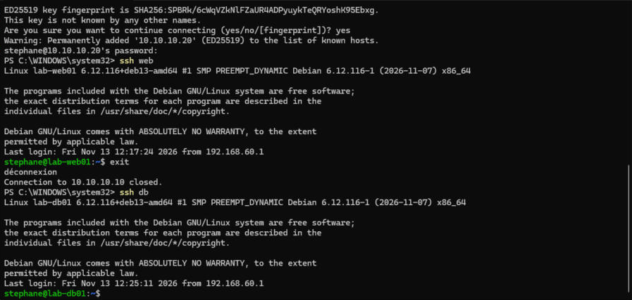
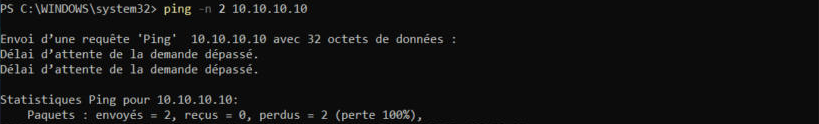
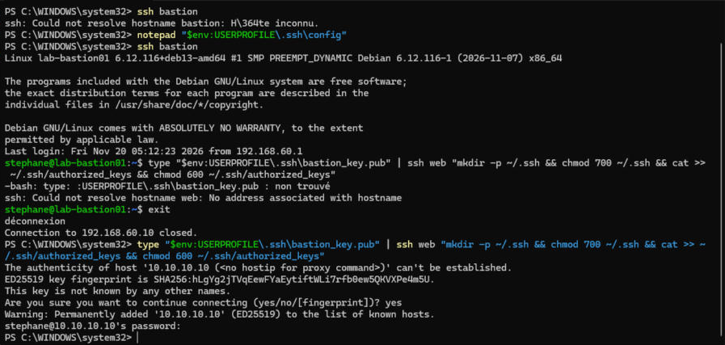
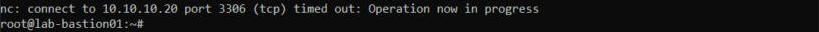

🇫🇷 **Français** · 🇬🇧 [English](README.en.md)

# 🛡️ Lab — Une seule porte d'entrée : construire un bastion SSH de A à Z

> **Debian 13 · VMware Workstation · SSH ProxyJump · nftables · Nginx · MariaDB**
> Projet de formation *Administrateur d'Infrastructures Sécurisées* — Stéphane Metche, novembre 2026
> ✅ 10 phases validées · 14 preuves · 9 pannes réelles diagnostiquées

> [!NOTE]
> **Environnement de lab.** Tout ce projet tourne dans des machines virtuelles sur mon PC (VMware Workstation), sur des réseaux privés de test.
> La « Boulangerie Martin » est un **scénario fictif** qui sert à illustrer un besoin d'entreprise réaliste : ce n'est pas une infrastructure de production.



---

## Le point de départ : la Boulangerie Martin

Imaginez une petite entreprise fictive : la **Boulangerie Martin**. Elle a un **site web** qui affiche ses horaires et ses produits, et une **base de données** qui contient ses clients et ses commandes.

Le réflexe le plus simple serait d'ouvrir chaque serveur sur le réseau pour pouvoir l'administrer. Mais chaque porte ouverte est une porte qu'un attaquant peut essayer de forcer : deux serveurs, deux portes, deux fois plus de risques.

**La question de ce projet :** comment administrer ces serveurs **sans jamais les exposer** ?

**La réponse : un bastion.** Un poste de garde à l'entrée du site. Tout le monde passe par lui, il vérifie le badge, et lui seul connaît le chemin vers les serveurs cachés. Une seule porte à surveiller, un seul journal à lire.

---

## Ce que j'ai construit (en lab)

```
            Réseau NAT VMnet8 (192.168.60.0/24)          Réseau interne VMnet2 (10.10.10.0/24)
                                                          (le PC hôte n'y est PAS branché)
 ┌──────────────┐  SSH 22 (clé)  ┌────────────────────┐   rebond SSH   ┌────────────────────┐
 │ PC Windows   │ ─────────────► │  lab-bastion01     │ ─────────────► │ lab-web01 (Nginx)  │
 │ 192.168.60.1 │                │ ens32 192.168.60.10│                │ 10.10.10.10        │
 └──────────────┘                │ ens34 10.10.10.1   │ ─────────────► ├────────────────────┤
                                 │ routage + NAT      │                │ lab-db01 (MariaDB) │
                                 └─────────┬──────────┘                │ 10.10.10.20        │
                                           │ sortie internet (apt)     └────────────────────┘
                                           ▼
                                  passerelle VMware 192.168.60.2
```

Trois serveurs Debian 13 :

- **`lab-bastion01`**, le poste de garde. Il a un pied dans chaque réseau : il est la seule machine joignable depuis l'extérieur, et il sert aussi de sortie internet aux deux autres.
- **`lab-web01`**, la vitrine (Nginx). Invisible depuis l'extérieur.
- **`lab-db01`**, la salle des coffres (MariaDB). Seul le serveur web a le droit de lui parler.

---

## Le parcours, en 5 chapitres

### Chapitre 1 — Poser les fondations (phases 1 à 2)

J'ai d'abord créé un **réseau virtuel isolé** (VMnet2), sans aucun câble vers mon PC. Ensuite, plutôt que d'installer Debian trois fois, j'ai construit **une VM modèle**, puis j'en ai tiré **trois clones liés** : trois serveurs pour presque la place d'un seul.

Le piège à éviter : un clone est un **jumeau parfait**, avec le même nom, le même identifiant système et les mêmes clés SSH. J'ai donc donné à chacun sa propre identité (`hostnamectl`, `machine-id`, `ssh-keygen -A`). Sans ça, voler une seule VM aurait permis de se faire passer pour les deux autres.

### Chapitre 2 — Transformer un serveur en poste de garde (phases 3 à 4)

Le bastion a reçu **deux adresses fixes**, une par réseau. Puis je l'ai transformé de **cul-de-sac** en **carrefour** (`ip_forward`), et en **standardiste** : le NAT (`masquerade`) permet aux serveurs cachés de télécharger leurs mises à jour sans jamais être visibles d'internet.

**Preuve que l'isolation fonctionne :** depuis mon PC, le serveur web ne répond tout simplement pas.



### Chapitre 3 — Remplacer les mots de passe par des clés (phases 5 à 6)

Un mot de passe peut se deviner. Une **clé ed25519**, non. J'ai généré une paire de clés sur mon poste, posé la clé publique sur les serveurs, puis **fermé toutes les autres portes** : plus de mot de passe, plus de connexion directe en `root`, un seul utilisateur autorisé.

Enfin, un simple fichier `~/.ssh/config` et l'option **`ProxyJump`** : je tape `ssh web`, et SSH traverse le bastion tout seul. La connexion reste chiffrée de bout en bout, et ma clé privée ne quitte jamais mon PC.



### Chapitre 4 — Ouvrir la boutique, sans ouvrir les portes (phases 7 à 8)

**Nginx** sur le serveur web, **MariaDB** sur la base. Mais comment voir un site qui n'est pas joignable ?

Avec un **tunnel SSH** : un tuyau chiffré qui part de mon PC, traverse le bastion et ressort devant le serveur web. Mon navigateur affiche `http://localhost:8080`… qui est en réalité le serveur caché.


Côté base de données, le compte applicatif `webuser` ne fonctionne **que depuis l'adresse du serveur web**, et seulement sur sa propre base. C'est le moindre privilège.

### Chapitre 5 — Verrouiller, puis prouver (phases 9 à 10)

Dernière couche : un **pare-feu nftables** sur chaque machine, avec une règle simple : **tout est interdit, sauf ce qui est écrit dans la matrice des flux**.

Le test qui résume tout le projet : **même le bastion ne peut pas ouvrir la base de données**. Seul le serveur web y a accès.



---

## Ce qui n'a pas marché du premier coup (et c'est le plus intéressant)

Un lab qui marche du premier coup n'apprend pas grand-chose. Celui-ci m'a donné **9 vraies pannes** à résoudre. Trois d'entre elles :

- **L'installeur Debian ne trouvait pas internet.** Un ancien TP avait modifié la passerelle du réseau NAT de VMware (`.254` au lieu de `.2`). La leçon : les réglages réseau de l'hyperviseur sont **globaux**, et un projet peut casser le suivant.
- **Le DNS a disparu en passant en IP fixe.** `ping 1.1.1.1` répondait, mais pas `ping deb.debian.org`. La route était bonne, c'était l'annuaire qui était vide.
- **Un serveur avait la bonne adresse, mais ne répondait pas.** La carte réseau virtuelle était branchée sur le mauvais réseau. La leçon : une adresse IP affichée ne prouve pas que le câble est au bon endroit.

À chaque fois, la même méthode : **tester du plus proche au plus lointain**. La carte, puis la passerelle, puis internet par adresse IP, puis le DNS.

👉 Toutes les pannes et leur diagnostic : [docs/problemes-rencontres.md](docs/problemes-rencontres.md)

---

## La sécurité en un coup d'œil

| Couche | Mise en œuvre |
|---|---|
| Isolation réseau | Web et DB sur un réseau sans accès depuis l'hôte : joignables uniquement via le bastion |
| Authentification forte | Clé ed25519, mots de passe et `root` interdits en SSH, `AllowUsers` |
| Pare-feu | nftables, politique « tout interdit sauf la matrice de flux » |
| Moindre privilège | Compte MariaDB limité à l'IP du serveur web et à sa base |
| Traçabilité | `LogLevel VERBOSE` : le journal SSH indique quelle clé s'est connectée |

### Matrice des flux autorisés

| De | Vers | Port | Usage |
|---|---|---|---|
| PC admin | bastion | 22 | Administration |
| bastion | web, db | 22 | Rebond SSH |
| bastion | web | 80 | Test HTTP / tunnel |
| web | db | 3306 | Application → base |
| web, db | internet (via NAT bastion) | 53, 80, 443 | Mises à jour |

Tout le reste est refusé.

### Plan d'adressage

| Machine | Carte | Réseau | Adresse | Passerelle | Rôle |
|---|---|---|---|---|---|
| lab-bastion01 | ens32 | NAT (VMnet8) | 192.168.60.10/24 | 192.168.60.2 | Entrée SSH + sortie internet |
| lab-bastion01 | ens34 | Interne (VMnet2) | 10.10.10.1/24 | — | Passerelle des VM internes |
| lab-web01 | ens32 | Interne (VMnet2) | 10.10.10.10/24 | 10.10.10.1 | Nginx |
| lab-db01 | ens32 | Interne (VMnet2) | 10.10.10.20/24 | 10.10.10.1 | MariaDB |

Convention : `.1–.9` réseau, `.10–.19` web, `.20–.29` bases de données.

---

## Ce que ce projet m'a appris

- **Penser « surface d'attaque »** avant de penser « ça marche » : chaque port ouvert doit avoir une raison d'exister.
- **Empiler des protections indépendantes** : si une couche cède, la suivante tient encore.
- **Prouver plutôt qu'affirmer** : un test qui doit **échouer** (ping, `nc`, mot de passe refusé) vaut autant qu'un test qui réussit.
- **Diagnostiquer avec méthode**, du plus proche au plus lointain, plutôt que changer des réglages au hasard.
- **Documenter en même temps que l'on construit** : ce dépôt a été rédigé au fil des phases, preuves comprises.

---

## Explorer le dépôt

| Dossier | Contenu |
|---|---|
| [`configs/`](configs) | Les fichiers de configuration réels des 3 serveurs et du poste d'administration |
| [`docs/procedure-personnelle.md`](docs/procedure-personnelle.md) | Refaire le lab de zéro, commande par commande |
| [`docs/preuves.md`](docs/preuves.md) | Tous les tests de vérification, avec leurs captures |
| [`docs/problemes-rencontres.md`](docs/problemes-rencontres.md) | Les 9 pannes réelles et leur diagnostic |
| [`docs/tunnel-ssh.md`](docs/tunnel-ssh.md) | Fiche mémo : tunnels SSH à travers un bastion |
| [`captures/`](captures) | Captures recadrées, sans donnée sensible |

---

## Compétences mobilisées

`Virtualisation VMware` · `Clones liés & snapshots` · `Adressage IP` · `Routage & NAT` · `DNS` · `Debian 13` · `systemd` · `SSH (clés, durcissement, ProxyJump, tunnels)` · `nftables` · `Nginx` · `MariaDB` · `Défense en profondeur` · `Méthode de diagnostic` · `Documentation technique`

---

*Stéphane Metche — en reconversion vers le DevSecOps.*
*Ce lab fait partie de mon parcours de formation AIS. Les retours et suggestions sont les bienvenus !*
