# Preuves de fonctionnement

Chaque capture est recadrée sur le terminal ou la page concernée. Aucun mot de passe n'apparaît.

## Phase 6 — Carnet SSH et rebond par le bastion

`ssh bastion` échoue avant la création de `~/.ssh/config`, puis entre directement après :

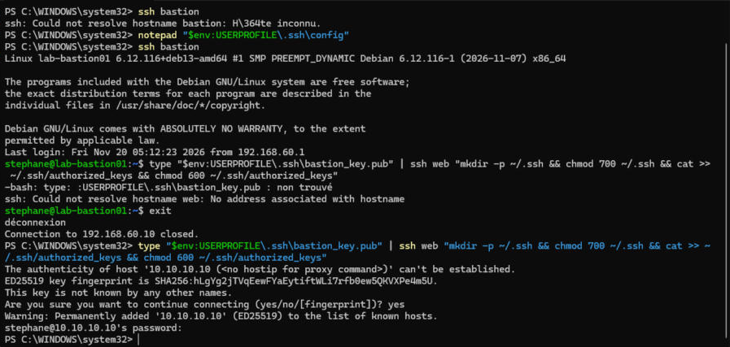

`ssh web` et `ssh db` traversent le bastion, sans mot de passe :

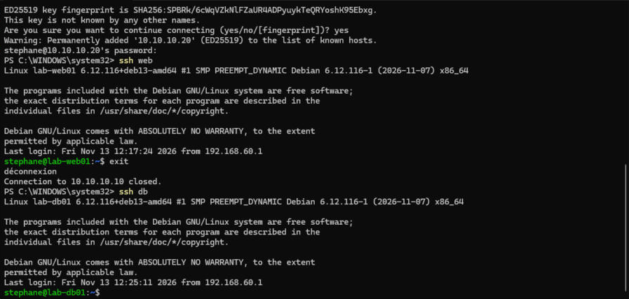

## Phase 7 — Nginx et tunnel SSH

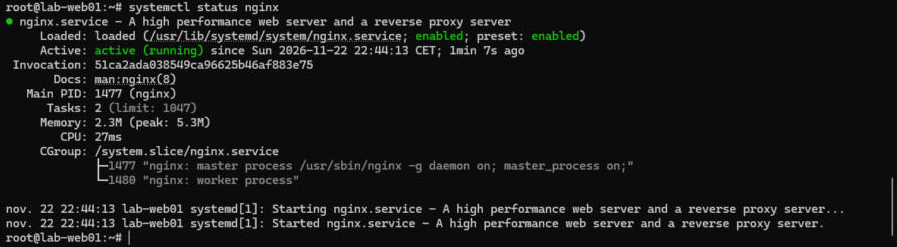

Le bastion voit la page de web :

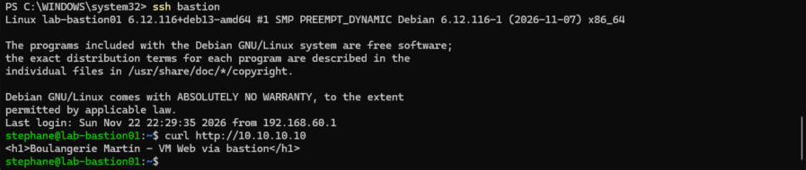

Le PC affiche la page via `ssh -N -L 8080:10.10.10.10:80 bastion` alors qu'il ne peut pas joindre web directement :

## Phase 8 — MariaDB

MariaDB n'écoute que sur l'adresse interne :

Le compte `webuser` fonctionne depuis web :

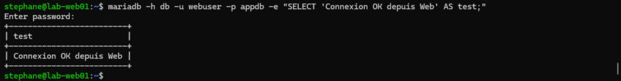

## Phase 9 — Pare-feu nftables

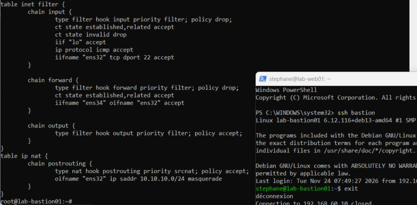

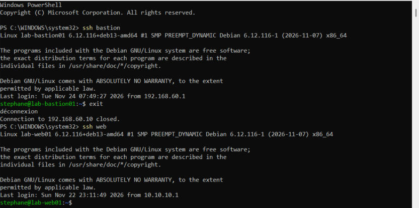

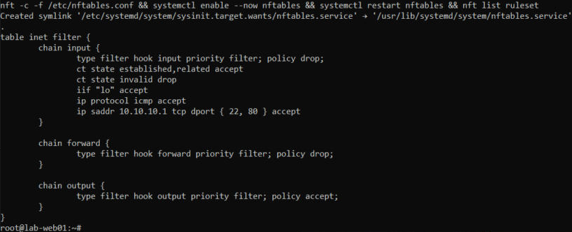

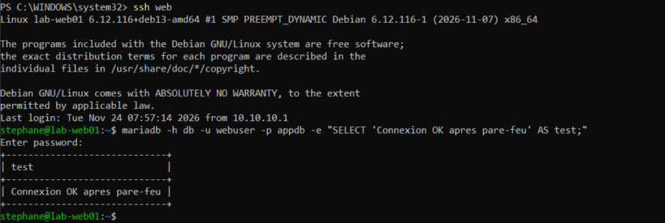

## Phase 10 — Vérifications finales

| Test | Attendu | Résultat |
|---|---|---|
| `ping 10.10.10.10` depuis le PC | Échec (isolation) | ✅ 100 % de perte |
| `ssh -o PubkeyAuthentication=no stephane@192.168.60.10` | `Permission denied (publickey)` | ✅ |
| `ssh bastion`, `ssh web`, `ssh db` | Connexion par clé, rebond | ✅ |
| `ip -br a` / `ip route` / `ip_forward` sur le bastion | 2 adresses, sortie `.2`, routage = 1 | ✅ |
| `curl http://10.10.10.10` depuis le bastion | Page HTML | ✅ |
| Tunnel + `http://localhost:8080` | Page HTML | ✅ |
| `mariadb -h db -u webuser` depuis web | Connexion OK | ✅ |
| `nc -zv -w 3 10.10.10.20 3306` depuis le bastion | **Bloqué** (timed out) | ✅ |

Isolation : le PC ne joint pas le réseau interne.

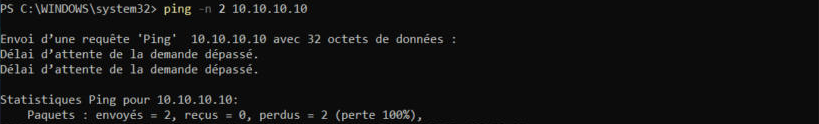

État réseau du bastion :

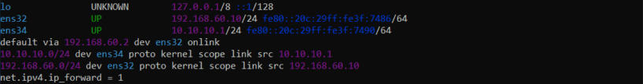

Défense en profondeur : même le bastion ne peut pas ouvrir la base.

